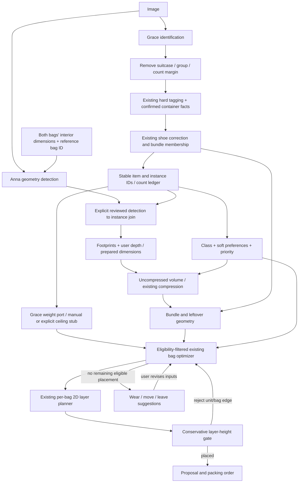

# PackWise pipeline integration review

Follow-up implementation: weight estimation, native `plan_trip`, liquid search,
shoe-width geometry and capacity provenance now exist. See
[current stage contracts and assumptions](pipeline-stages.md). The inventory and
audit below record the state at the original review, before that follow-up.

Reviewed against the local checkout on 2026-10-31, including uncommitted identification/bundling work. Ownership below follows the supplied plan; Git authorship was not used to infer ownership. No existing stage algorithm, shared type, API, UI, or store was rewritten. New integration code is under `src/lib/pipeline/`.

## 1. Actual inventory

| Stage / source | Actual input | Actual output / behavior |
| --- | --- | --- |
| Grace identification: `src/lib/vision/openai-object-agent.ts`, `identify-objects.ts` | JPEG/PNG/WebP bytes, server-configured OpenAI agent | Strict raw `{label,count,attributes,flags}[]`. No IDs, positions, sizes, capacities, mass, nesting, or contents. Individual shoes, empty containers. Attribute whitelist includes drinking bottles/flasks as well as mugs. |
| Count normalization: `postprocessObjectCounts` | Raw four-field entries | Validates and canonicalizes labels, removes labels containing suitcase, merges equal label+attributes, then adds one when the merged raw count exceeds four. No original-count ledger returned. |
| Safety: `tagIdentifiedObject`, `src/lib/packing/baggage-tags.ts` | Normalized entry + optional **separate** `BaggageDetails`: capacity in L, physical form, tool/blade lengths in cm, exceptions | Same four fields + `placement_tag`: `carry-on-only`, `checked-only`, `needs-review`, `no-matching-rule`, or `prohibited`. Flags record empty/full and review. More nuanced than the brief's binary rules: scissors/tools have exceptions. Without capacities, liquid size is unknown, not assumed under 100 ml. |
| Grace bundling: `src/lib/packing/bundles.ts` | Tagged entries with adjusted counts, optional IDs | `{items,bundles}`. IDs hash normalized label+attributes unless supplied. Shoe counts above five lose the prior synthetic +1; odd actual shoe retained and flagged. Shoe slots pair only inside one entry. Liquid membership follows `assumed_full`, split by existing tag. Bundle tags use underscores, unlike item tags. Invariants reject conflicting/prohibited members. No geometry or mass. |
| Existing upload wrapper/API: `packing-inventory.ts`, `/api/identify-objects` | Image only | Calls identification, count normalization, tagging **without user facts**, bundling. Returns `{items,bundles}`. Does not call dimensions, weight, compression, or planning; no way to supply liquid capacities in this endpoint. |
| Anna dimensions: `src/lib/photo-packing/detect.ts`, `geometry.ts`, browser component/worker | RGBA `Raster`, **one** selected bag's usable interior length/width in **cm**, analysis ID, optional original image size | `Analysis`: detected suitcase quadrilateral, projective transform, per-axis scale, independently numbered component IDs, raw/rectified polygon outlines, pixel area, cm² area, oriented cm envelope, quality text. **No depth/3D dimensions/volume or semantic labels.** Not a scalar pixels-to-inches algorithm. |
| Browser photo review: `PhotoAreaPacking.tsx`, `Review` | Analysis + user names, category 1/2/3, confirmation, ignore flag, optional inventory link | Explicit detection→inventory association. Existing planner permits an inventory entry to link only once, requiring an entire multi-count bundle to be one region. Does not expand counts or automatically match names. |
| Compression: `src/lib/compression.ts` | `{itemId,objectKind,fillMaterial,uncompressedVolumeLiters}`, reference list | `estimated` with ratio, compressed whole-entry liters, reference ID, warnings, or `unavailable`. Kinds: puffer-jacket, pillow, sleeping-bag, blanket. No category field/gate and no packed shape. |
| Bedding/reference sources: `compression-bedding.ts`, `compression-retailers.ts`, `/api/compression` | Explicit retailer measurement strings/HTML, fixed sources; API takes compression request | Material-matched references with units/provenance. Bedding supports wool/cotton pillow/mattress evidence for blankets. Docs report live bedding data unavailable. These are **volume** scrapers, not object-weight scrapers. |
| Grace weight estimation/scraping | **Not found** anywhere in tracked/untracked source or docs searched | No weight agent, lookup table, scrape contract, or fixed power-bank ceiling found. `quickstart.py` is an unrelated Anthropic renewable-energy example. UI/demo weights are manual/sample values. |
| Bag assignment: `src/lib/packing/optimize-packing.ts` | `Pick<PackWiseData, trip/items/suitcases/packingPlan>`, positive confirmed whole-entry kg/L/cm dimensions | Greedy `packingPlan` assignments with `packOrder`, and unassigned entries with per-bag reasons. Whole entries indivisible. Only `carryOnRequired` as baggage rule; no checked-only/review/prohibited/priority/top preference support. Individual rotated box fit + aggregate mass/volume, not simultaneous 3D packing. |
| Anna layering: `src/lib/photo-packing/plan.ts` | Full shared data, **already selected** suitcase ID, `Analysis`, confirmed `Review[]` | `AreaPlan` of 2D layers, rectangles, unplaced detections; categories 1→2→3 share partial layers. Unbounded layer count; no height/closure, compression, mass or bag choice. Known linked fragility/cleanliness get limited checks. `applyAreaPlan` can move linked entries, but is not used by the new orchestrator. |
| Grace fallback / `plan_trip` | **Not found** | Existing optimizer gives textual reasons/actions. No wear/move/leave decision stage or retry orchestration. |

## 2. Handoff audit, ranked

P0 prevents a correct plan or can violate a hard constraint; P1 causes incorrect/incomplete estimates or decisions; P2 is integration/UX quality. This audits current code, not current aviation-policy validity.

| Severity | Handoff | Actual output → required input | Mismatch and smallest bridge |
| --- | --- | --- | --- |
| P0 | Identification → dimensions association | Aggregate labels/counts without regions → independent component IDs/polygons | Confirm explicit detection→instance IDs. No positional/label-order join. Keep identity detection and geometry detection parallel. |
| P0 | Two-bag capture → detector | Two possible open interiors → exactly one unambiguous interior | Detector can reject the intended scene. Current supported default: photograph one calibration interior while supplying both bags' dimensions. Anna must support explicit selection/multiple candidates for the original UX. |
| P0 | Dimensions → assignment/compression | 2D footprint only → three dimensions and positive volume | Require user height/complete prepared dimensions. No depth guessed from a single overhead photo. |
| P0 | Identification → mass → assignment | Labels/attributes → no existing estimator → positive kg | New stub accepts user per-unit mass or explicit ceiling; otherwise returns needs-input. No invented fixed ceiling or claim of scraping. |
| P0 | Hard tags → legacy optimizer | Five-state tags → boolean carryOnRequired | Eligibility-filtered optimizer calls; review/prohibited blocked. Never translate checked-only to false and permit cabin packing. |
| P0 | Tagging → liquid bundles | Missing container capacity → unknown placement grouped into cabin bucket with review flag | Supply confirmed per-container capacity before the existing tag function. Review flag blocks packing; “liquids_cabin” name itself grants no cabin clearance. |
| P0 | Bundle members → packing/mass | Massless references and quantities → indivisible sized entries | Resolve exact instances; derive box separately; temporary planner mass is sum of source item mass. Never add bundle mass to item totals. |
| P0 | Assignment → layers → fallback | Individually fitting rotated 3D boxes → 2D fixed-height-orientation footprints and unlimited layers | Layer after assignment. Conservative sum-of-max-layer-height gate; failed unit/bag edges excluded and assignment rerun. Neither algorithm proves physical fit. |
| P1 | Raw counts → measurement/weight | +1 creates an unpictured unit; shoe F undoes it | Preserve count ledger; real ordinal IDs plus explicit `count_margin` instance. No pixel region for margin. Inherit max per-axis envelope within entry; count its unit mass once. |
| P1 | Removed suitcase → calibration | Suitcase absent from inventory → reference still needed | Keep image and separate `{bag_id, analysis}` calibration entity, not a packed suitcase item. |
| P1 | Equal labels → quantities/capacities | Same label+attributes merged → possibly different sizes, weights, capacities | Current group-level user facts assume homogeneous units. Instance geometry overrides exist; heterogeneous per-instance mass/liquid facts need owner changes before use. Do not infer 50 ml and 250 ml shampoo are identical. |
| P1 | Compression → packed geometry | Ratio/liters only → bounding dimensions for layers/bundles | Retain uncompressed envelope; never cube-root scale all axes. User supplies packed bundle box, or explicitly accepts side-by-side conservative envelope. |
| P1 | Class mapping → compression/layers | User categories 1 rigid, 2 foldable, 3 puffy → alleged compression category 1 | Code contradicts allegation: compression has **no** category gate. Proposed map uses category 3 for puffer/pillow/blanket; explicit material required. |
| P1 | Soft policy → optimizer/layers | No soft policy fields → preferences/priority needed | Explicit provisional label list and user usage flags. Must-have first and cabin preference via wrapper passes. Existing layer solver cannot guarantee top preference; reports unmet preference. |
| P1 | Shared quantity → optimizer | Whole-entry stored kg/L/dims → per-instance units/bundles | Adapter sets temporary planner quantity=1 and copies already-derived totals. Multiplying legacy weight by count again would be wrong. |
| P1 | Inches → existing cm geometry | Existing code is **cm**, despite suspicion → requested canonical inches | `*2.54` at legacy boundaries, `/2.54` on output. kg/L retained; cubic inches→L factor .016387064. No global shared-type migration. |
| P1 | Current IDs → persistent identity | Content hash per attribute group; detection ordinal per photo → cross-stage stable keys | Parent IDs preserved, child instance IDs stable within the run. Attribute edits/new photos need reviewed identity reconciliation; current hashes aren't persistent physical-object IDs. |
| P1 | Exceptions/unknowns → UI/store | needs-review/prohibited/uncertain estimates → shared Item lacks states | New proposal DTO retains states and blocks unresolved units; no automatic store import or Apply. |
| P1 | Existing handling → integration | Legacy photo linking can check fragility/cleanliness → identifier has neither | Temporary legacy entries use ordinary handling with an explicit warning. Requested owner contract addition before real application; no claim of crush/contamination safety. |
| P1 | Fallback → final decisions | Only rejection messages → permission to wear/discard/move | Bounded automatic reassignment; wear/leave are proposals requiring user choice. Must-have never suggested leave-at-home. |
| P2 | Photo bytes → browser detector | Encoded image vs decoded/downsampled RGBA | Accept existing browser `Analysis` or decoded `Raster`; server image decoder is deliberately not invented. Same orientation/analysis coordinates must be retained. |
| P2 | Semantics → transport | Hyphen item tags vs underscore bundle tags; label vs name | Preserve source fields and adapt at boundaries; never rename canonical fields. |
| P2 | App integration | Separate photo, inventory, compression, identification flows | New orchestrator is a library/CLI, not yet a dashboard/API/store replacement. No new network calls or UI implied. |

## 3. Canonical schema and ownership

The implemented contract is `src/lib/pipeline/contracts.ts`. It extends the existing identified item; `src/lib/types.ts` remains unchanged. Canonical enrichment is append-only **after** the mandatory legacy count/tag/F boundary. Making raw→corrected counts literally immutable inside that earlier stage would contradict the retained algorithms. The new `count_history` keeps all three count values without changing those algorithms.

| Fields | Written by | Meaning |
| --- | --- | --- |
| `id,label,count,attributes,flags,placement_tag` | Existing normalization/tag/F, ID adapter | Final source item and quantity; unchanged during enrichment/planning. |
| `count_history.{ai_count,after_margin,final_count}` | Identification adapter | Raw grouped count, +1 output, F shoe-corrected count. |
| `instances[].{id,item_id,origin}` | Instance expansion | `${item.id}:instance:N`; observed means AI-counted, **not** independently verified pixels. Extra margin has origin `count_margin`. No new AI call. |
| `instances[].detection_id,region` | Explicit join adapter | Photo/analysis ID, analysis pixel dimensions, raw polygon in those pixel coordinates. No mask invented; polygon suffices. Suitcase calibration outside item list. |
| `instances[].dims.{value,source}` | Dimensions adapter | Prepared rectangular dimensions in inches; photo footprint+user height, full user input, or margin envelope. Overrides per instance supported. |
| `classification.{category,part_class,source,compression?}` | Mapping/user adapter | Category 1/2/3; compression object kind and actual fill/material where known. Separate from legacy inventory categories. |
| `preferences.{carry_on,on_top,reasons}`, `priority` | Plain-code preference/user adapter | Soft wishes never relax hard tags; must_have/nice_to_have. |
| `weight.{unitKg,totalKg,source,review_required}` | Weight stage/stub | Homogeneous-entry unit weight and `count * unitKg`, including margin. Unknown leaves field unavailable, never zero. |
| `volume.{uncompressedLiters,packedLiters,source,reference_id?,warnings}` | Volume/compression adapter | Sum of instance bounding-box liters; optional unchanged compression function. Compression distribution uses each instance's baseline volume, not equal fractions of unequal boxes. |

Separate derived lists:

- `bundles`: unchanged existing massless membership contract. No dimensions/mass added to these strict five-field objects.
- `units`: bundle or leftover instance → exact `instance_ids`, inches envelope, packed liters, source, category, allowed bag IDs and preferences. No own mass. Geometry of a singleton liquid still goes through its bundle.
- `placements`: unit IDs → bag IDs, layer/order and x/y inches. Member IDs trace to the same source item through all stages, including fallback.
- `calibration`: selected bag ID + original `Analysis`; never an item to pack or weigh.

The temporary shared-optimizer projection uses `item-unit-${unit.id}`, with an explicit reverse lookup, not a new source identity. It is never written into shared inventory. Group total mass is the only source; temporary per-unit mass is read from that source and never added again. A bundle has no bag/tare weight: a real extra liquid pouch must be separately listed/weighed if present. Its material thickness/shape is not automatically inferred.

## 4. Corrected data flow



Membership bundling runs early because existing F changes shoe source counts. **Bundle geometry** runs later, after tagging, measurement and compression and before packing. Weight and dimensions are parallel enrichments of primitives; weight never consumes bundles. This is a graph, not one linear list.

Retry excludes each rejected unit/bag edge, so at most `2 * number_of_units + 1` assignment/layer passes occur. Each retry recomputes loads; no units disappear. The heuristic does not backtrack all combinations or prove infeasibility. New user decisions start a new run; automatic fallback never silently removes a real item.

Required inputs for this implementation:

1. Image and either decoded/orientation-corrected raster or existing browser Analysis, plus stable photo ID. Inject the existing agent's `identify` function.
2. One carry-on and one checked bag, stable IDs/kinds, **usable interior** L/W/H in inches, empty weight kg, total weight limit kg, usable capacity L. Select the single visible reference interior. Limits are user facts, not inferred allowances.
3. Confirmed detection→instance matches, or explicit per-entry/per-instance prepared dimensions. User height is required when only a photo footprint exists. Unmatched detections are reported.
4. Per-container liquid capacity in liters and needed battery/tool/exception facts through the existing tagging contract. Container capacity is not inferred from bounding volume. Current interface assumes identical facts for all units of one entry.
5. Unit weight per entry, or an explicitly chosen fallback upper-bound kg when unavailable. No universal conservative unknown-item weight exists in code.
6. Category overrides where mapping is missing/wrong; actual fill/fabric for pillows/blankets. Down/synthetic puffer type maps directly. Optional compression references with provenance.
7. Must-have/nice-to-have, valuables, change-of-clothes usage, cabin/top overrides, wearable permission. No random shirt/pants choice. Current usage flag is entry-wide; select/split quantities in a future identity-aware UI.
8. Measured packed bundle dimensions or explicit acceptance of side-by-side envelope approximation; future wear/leave decisions are user-confirmed.

## 5. Glue implementation and defaults

```ts
import { createPipeline } from '../src/lib/pipeline/run-pipeline.ts';
// Existing configured provider; agent creation/credentials remain server-side.
const run_pipeline = createPipeline({ identify: image => agent.identify(image) });
const result = await run_pipeline(image, suitcase_dims, user_inputs);
```

All stages are named injectable functions in `PipelineStages`: identify, normalize, tag, bundle, detect, measure, classify, preferences, weight, volume, geometry, assign, layer, fallback. They are deliberately separate from browser state. Default identification throws an actionable configuration error; default weight port returns unavailable without user mass/ceiling. No secret lookup, paid model call, live retailer scrape, or guessed default mass happens implicitly. Existing provider APIs remain unchanged.

**ASSUMPTION defaults (proposals, not discoveries):**

- Canonical length is inches per this request; existing shared cm interfaces and kg/L remain intact. Do not globally relabel cm numbers as inches.
- Count margin inherits per-axis maxima within its entry, receives no pixels and weighs one additional unit. Final F behavior remains exactly as previously implemented: seven shoes → eight → seven, three pairs and one real leftover.
- Categories: shoes/books/notebooks/laptops/power banks/mugs/bottles and flagged full liquids→1; shirts/pants/socks/towels/empty soft bag labels→2; typed puffers/pillows/blankets/sleeping bags→3. Unknowns require input. Shoes and bags can differ in construction; override the provisional map. Only typed puffers imply fill; pillow/blanket material is never guessed.
- Soft shortlist: medication, medicine, prescription medication, passport, documents, travel documents, wallet, jewelry, laptop, camera; user valuables/change-of-clothes flags add the same preferences. This is configurable policy, not part of hard tagging. Default priority is must_have so omission is never silently optional.
- Compression unavailable → retain uncompressed box volume and warning. A compression ratio alone does not shrink dimensions. This can reject a compressible item that would fit after actual shaping.
- Optional bundle approximation: lay boxes side by side along length; width/height are maxima. Use the enclosing box's volume (including voids), not sum of member volumes. No bag fabric allowance or nesting benefit is guessed. Default requires a supplied packed shape.
- Legacy optimizer wrapper groups by eligibility, honors must-have before optional entries, reserves single-bag-constrained capacity before soft cabin preferences within each priority, then uses the unchanged greedy algorithm. This is a compatibility policy, not `plan_trip` or a new optimal solver.
- Layer adapter uses the existing solver with explicitly virtual prepared rectangles. It adds a conservative height gate outside the algorithm. Category order remains unchanged, and top preferences may be unmet. Virtual Analysis is never returned as image evidence.
- Fallback wear requires explicit `canWear`; leave-at-home only for nice-to-have. Suggestions are not proof that a move or wearing resolves the whole trip. Review unresolved restrictions first.

## 6. Reproduction and actual synthetic output

Run from the repository root:

```sh
node --experimental-strip-types --test scripts/pipeline-integration.test.ts
node --experimental-strip-types scripts/pipeline-demo.ts
npm run check
```

The complete captured stdout is [pipeline-synthetic-output.json](pipeline-synthetic-output.json). It is generated by the CLI, not a handwritten expected result. The image is a controlled RGBA raster with one reference opening and fifteen separated rectangles. Identification is a stub with known raw labels. Actual detector/matching, count/tag/bundle code, compression arithmetic, bag optimizer and layer solver all run. Masses and the compression reference are explicitly synthetic; no real AI accuracy or retailer data is being validated.

| Synthetic source | Actual result |
| --- | --- |
| 7 shirts | 8 units, 7 pixel associations, 1 margin without pixels; 1.6 kg total |
| 3 sneakers | 1 pair + 1 unpaired shoe; 1.2 kg total |
| Shampoo 50 ml | `liquids_cabin`, tag `either` (not forced cabin), one member |
| Lotion 250 ml | `liquids_checked`, one member, assigned checked |
| Power bank | Carry-on only, assigned cabin |
| Down puffer | Category 3, existing compression ratio 0.5 applied; full footprint retained |
| Oversized surfboard | Unassigned, user-decision fallback; leave-at-home offered because nice-to-have |
| Entire run | 7 source entries, 16 individual units, 3 bundles, 15 packing units, 14 placed, 1 fallback; 9.03 kg source total including the unassigned 5 kg board; 4.03 kg packed contents; 1 assignment/layer pass; no missing-input issues |

Tests also cover missing mass/depth, explicit fallback mass, immutable inputs, synthetic-pixel rejection, hard-rule bypass rejection, unknown liquid capacity, missing bundle shape, unequal instance volumes, preserved shoe count provenance, and second-pass moves after injected and real height failures. Soft cabin preferences cannot consume capacity ahead of hard cabin-only items at the same priority. The existing server at http://localhost:3000 is used only for application-regression HTTP verification; this library has no new UI or HTTP endpoint.

## 7. Owner requests and unresolved questions

No request below has been silently implemented inside an owner's algorithm.

| Owner from plan | Requested interface change / decision |
| --- | --- |
| Grace — identification | Return/provide a stable instance manifest and preserved raw-count provenance, or accept reviewed matches from Anna's detections. How should identity survive attribute edits, reordering, and a new photo? |
| Anna — dimensions | Accept an explicitly chosen calibration suitcase/region in a photo containing both bags; expose pixel coordinate frame consistently. Is an additional depth source planned, or will users supply prepared heights? |
| Grace — weight | Provide estimator module location if outside this checkout. Accept label+attributes+empty/full assumption+count and return unit/total kg, uncertainty/fallback/source evidence. Define power-bank ceiling and per-label/unknown conservative ranges; support per-instance differences when needed. |
| Grace — tagging/identification | Allow separately sized same-label containers to retain distinct identity/facts before aggregation. Which UI captures per-container capacities, battery exceptions and review resolution? Existing agent deliberately cannot emit capacities. |
| Anna — compression | Confirm category naming (repo says category 3 puffy), material source, and how packed shape is supplied alongside compressed liters. Are complete eligible wool/cotton sources available elsewhere? |
| Planner owner (not established by code) | Is `plan_trip` on another branch? Add allowed bag IDs, priority and weighted soft preferences to its interface. Current wrapper preserves the existing solver but is only a deterministic compatibility heuristic. |
| Anna — layers | Accept prepared packing units independently of `Analysis`/reviews; expose depth/height-aware feasibility and top preferences, preserving current internal packing algorithm where possible. Define fragility/cleanliness input. |
| Grace — bundles/fallback | Confirm measured bundle shape vs conservative envelope, pouch tare accounting, and retaining real odd shoes above six (earlier prose conflicted with explicit test). Define user-approved wear/leave behavior and quantity splitting. |
| Team / product | Can the interim flow use one visible calibration interior and manually entered heights? Must all these assumptions block Apply until confirmed? Who owns frontend/API/store integration? |

Questions requiring your decision, prioritized:

1. Are the missing weight estimator and `plan_trip` in another branch/file, and who owns the latter?
2. Is one visible reference interior acceptable temporarily, or must both suitcases remain visible in the first supported release?
3. Where will prepared height, actual packed bundle shape, liquid container capacity, and fallback mass ceiling come from?
4. Should same-label objects with different capacities/masses become separate entries before aggregation? The current AI schema cannot distinguish that case reliably.
5. Confirm the category map, soft shortlist, default must-have policy and entry-wide change-of-clothes selection; should preferences instead target selected instance IDs?
6. Confirm real odd shoes remain after F, including counts above six, and whether a separate liquid pouch's measured shape/tare should be required.

Until those decisions and UI wiring are supplied, this is a runnable integration proposal with explicit missing-input states, not a production end-to-end photo packing feature.
